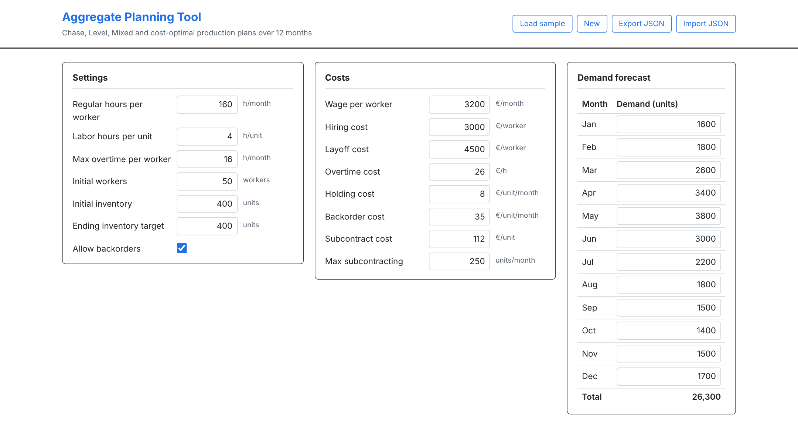
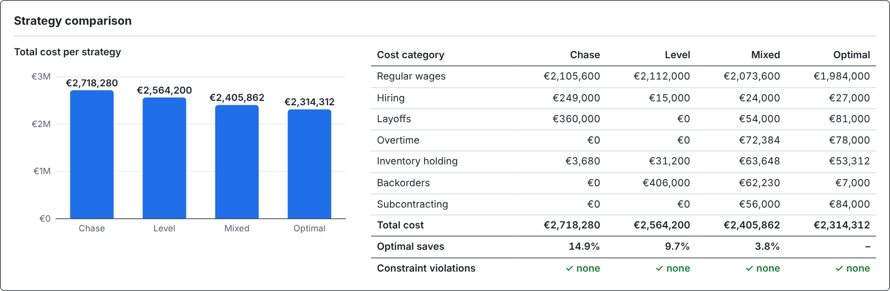
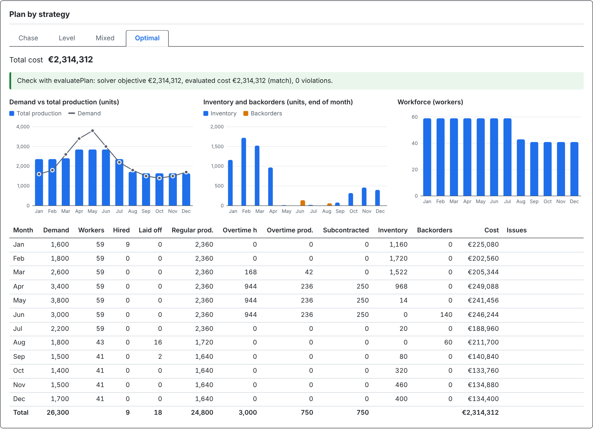
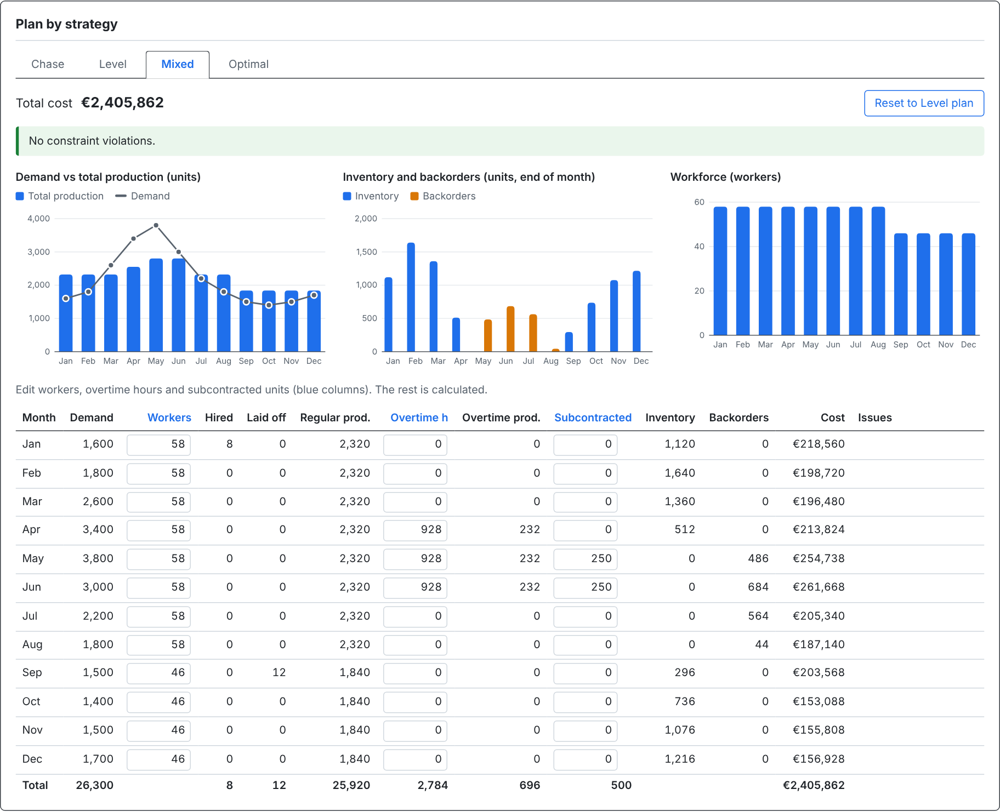

# Aggregate Planning Tool

A browser-based tool for aggregate production planning over a 12-month horizon. It compares the
classic **Chase** and **Level** strategies with a user-defined **Mixed** plan and a **cost-optimal**
plan found with linear programming. Everything runs in the browser: there is no backend.



## Features

- **Inputs:** planning settings, cost parameters and an editable 12-month demand forecast.
  - Invalid values get a red border and a short message, and revert to the last valid value on blur.
  - A comma is accepted as the decimal point.
- **Four strategies:**
  - **Chase:** the workforce follows demand each month.
  - **Level:** one constant workforce for the whole year.
  - **Mixed:** you set workers, overtime and subcontracting per month; the rest is calculated and
    violations are shown next to each row.
  - **Optimal:** the minimum-cost plan from a mixed-integer linear program.
- **One evaluation function for every plan:** the same `evaluatePlan` gives the total cost, the
  cost breakdown by category, and the list of constraint violations.
- **Independent check of the optimal plan:** the solver's plan is re-evaluated with `evaluatePlan`,
  and its cost must match the solver's objective.
- **Comparison:** a bar chart of total cost per strategy, the cost breakdown by category, and the
  savings of the optimal plan in %.
- **Charts:** plain SVG charts per strategy for demand vs production, inventory and backorders,
  and workforce.
- **Save and load:** auto-save to localStorage, plus Load sample, New, and JSON export/import.
  Imported files are validated, and the current data is kept if a file is invalid.





## The model

Notation: `t = 1…12` months, `D(t)` demand, `u = hoursPerWorkerPerMonth ÷ laborHoursPerUnit`
regular units per worker per month. Initial values: `W(0) = initialWorkers`,
`I(0) = initialInventory`, `B(0) = 0`.

### Decision variables (per month t, all ≥ 0)

| Variable | Meaning |
| --- | --- |
| `W(t)` | workers (integer) |
| `H(t)` | workers hired (integer) |
| `L(t)` | workers laid off (integer) |
| `P(t)` | regular production (units) |
| `O(t)` | overtime hours |
| `S(t)` | subcontracted units |
| `I(t)` | inventory at the end of the month (units) |
| `B(t)` | backorders at the end of the month (units) |

Overtime production is not a separate variable: it is `O(t) ÷ laborHoursPerUnit`.

### Objective

```
minimize  Σ over t of [ wagePerWorkerPerMonth        × W(t)
                      + hiringCostPerWorker          × H(t)
                      + layoffCostPerWorker          × L(t)
                      + overtimeCostPerHour          × O(t)
                      + holdingCostPerUnitPerMonth   × I(t)
                      + backorderCostPerUnitPerMonth × B(t)
                      + subcontractCostPerUnit       × S(t) ]
```

### Constraints (for every month t)

```
Workforce balance:   W(t) = W(t−1) + H(t) − L(t)
Inventory balance:   I(t−1) − B(t−1) + P(t) + O(t) ÷ laborHoursPerUnit + S(t) = D(t) + I(t) − B(t)
Regular capacity:    P(t) ≤ u × W(t)
Overtime limit:      O(t) ≤ maxOvertimeHoursPerWorkerPerMonth × W(t)
Subcontract limit:   S(t) ≤ maxSubcontractUnitsPerMonth
No backorders:       B(t) = 0 for all t, if backorders are not allowed
End of horizon:      B(12) = 0  and  I(12) ≥ endingInventoryTarget
Non-negativity:      all variables ≥ 0;  W, H, L integer
```

The model is built in [`src/lib/optimizer.js`](src/lib/optimizer.js) and solved with
[javascript-lp-solver](https://github.com/JWally/jsLPSolver) (branch and bound for the integer
variables). It has 96 variables, 36 of them integer, and 62 constraints. The sample solves in a
few milliseconds. If the integer solve does not return an integral solution within 3 seconds, the tool
solves the continuous relaxation instead and shows a notice that workers may be fractional.

## How Chase and Level are defined

Both strategies use regular time only (no overtime, no subcontracting). Both end month 12 at the
ending inventory target, so all four strategies are compared on equal terms.

- **Chase:** each month, hire or lay off so that regular production covers that month's demand:
  `W(t) = ⌈(D(t) + target if t = 12 − net inventory carried in) ÷ u⌉`.
  The surplus from rounding up is carried as inventory and lowers the next month's requirement.
- **Level:** one constant workforce for all 12 months, hired or laid off in month 1. It is the
  smallest whole number that covers `Σ D(t) + endingInventoryTarget − initialInventory` over the
  horizon. Inventory and (if allowed) backorders absorb the monthly differences.
  - If backorders are not allowed, the workforce is raised until no month has a shortage. This is
    computed directly as the maximum over t of `⌈(D(1) + … + D(t) − initialInventory) ÷ (t × u)⌉`,
    which gives the same result as adding one worker at a time.
- **Mixed:** you enter `W(t)`, `O(t)` and `S(t)`. Hiring, layoffs, production, inventory and
  backorders follow from the balance equations above. Without a saved Mixed plan, it is pre-filled
  with the Level plan, and the "Reset to Level plan" button restores it.

## Assumptions

- One aggregate product family. All quantities are monthly and costs are linear.
- Every worker is paid for the full month. In Chase, Level and Mixed, the workforce always produces
  at full regular capacity (no idle time); the optimal plan may produce below capacity.
- Hiring and layoffs take effect at the start of the month. The initial workforce is not counted
  as hired.
- Inventory and backorders are measured at the end of the month, and holding and backorder costs
  are charged on those values. Backordered demand is served later, never lost.
- No lead times, no learning effects, no capacity limit on hiring or layoffs.
- The overtime limit is per worker in the same month. Subcontracting is limited per month.
- Comparisons in `evaluatePlan` use a relative tolerance of 1e-6, so solver round-off is not
  reported as a violation.
- Costs are in EUR. The sample data is invented.

## Validation

- **Independent check of the optimal plan.** The solver's plan is passed to `evaluatePlan`, which
  does not use the LP model. It recomputes the cost with the cost formula and checks every
  constraint:
  - overtime, subcontracting and backorder limits;
  - backorders in month 12 and the ending inventory target;
  - the workforce and inventory balances, regular capacity, the overtime-production relation, and
    non-negative values.

  The UI shows the solver objective next to the evaluated cost. Unit tests require 0 violations
  and matching costs on several data sets.
- **Hand-checked examples** for Chase, Level (with and without backorders) and the optimizer, on a
  small test project. The arithmetic is in the test comments.
- **Lower and upper bounds.** The integer optimum must cost no more than Chase, Level, the default
  Mixed plan and the sample Mixed plan, and no less than the continuous relaxation.
- **Cost breakdown.** The cost by category and the cost by month both sum to the total.

Run all tests with `npm test`.

### Results for the sample data

Garden equipment manufacturer with a spring peak (26,300 units per year, peak 3,800 in May).

| Strategy | Total cost | Optimal saves | Violations |
| --- | ---: | ---: | ---: |
| Chase | €2,718,280 | 14.9% | 0 |
| Level | €2,564,200 | 9.7% | 0 |
| Mixed (sample plan) | €2,405,862 | 3.8% | 0 |
| **Optimal** | **€2,314,312** | – | 0 |

The optimal plan:
- **Jan:** hires 9 workers (to 59).
- **Jan–Mar:** builds inventory up to 1,720 units.
- **Mar–Jun:** uses overtime, at the 16 h/worker cap from April to June.
- **Apr–Jun:** subcontracts the maximum 250 units per month on top of the overtime.
- **Aug–Sep:** lays off 18 workers after the peak.

Overtime costs €104 per unit and subcontracting €112, so overtime is used first and
subcontracting only once overtime is at its cap.



## Run locally

Requires Node.js 20.19+ or 22.12+ (needed by Vite 8).

```bash
npm install
npm run dev      # start the dev server at http://localhost:5173
npm test         # run the unit tests (Vitest)
npm run lint     # run ESLint
npm run build    # production build in dist/
```

## Deploy

The repository includes a `vercel.json` for Vite.

1. Import the GitHub repository in [Vercel](https://vercel.com/new).
2. Vercel detects Vite: build command `npm run build`, output directory `dist`.
3. Deploy. Every push to `main` triggers a new deployment.

There is no backend and there are no environment variables. Any static host that serves `dist/`
works as well.

## Tech stack

- React + Vite, JavaScript
- Plain CSS with CSS variables, no UI library
- Charts in plain SVG, no chart library
- [javascript-lp-solver](https://www.npmjs.com/package/javascript-lp-solver) for the
  (mixed-integer) linear program, running in the browser
- Vitest for unit tests, ESLint for linting
- Hosted on Vercel

Project structure:

```
src/
  components/   React components (inputs, tables, charts, comparison)
  hooks/        project state, auto-save and import/export actions
  lib/          pure logic: model, plan evaluation, strategies, optimizer, validation, I/O
  data/         sample project
```

## Related projects

Part of a series of production planning and lean tools:

- [Value Stream Mapping tool](https://github.com/CharilaosStavrou/vsm-tool)
- [Kanban / Supermarket Calculator](https://github.com/CharilaosStavrou/kanban-calculator)

## Future improvements

- **Multiple product families:** aggregate plans for several families that share capacity.
- **Demand uncertainty:** scenarios or safety stock to test how robust a plan is to forecast error.
- **Disaggregation into a master production schedule:** split the aggregate plan into end items
  and weeks.

## License

[MIT](LICENSE) © 2026 Charilaos Stavrou
